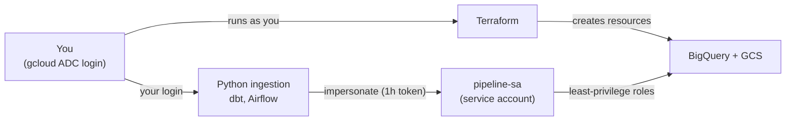

# batch-pipeline-gcp

## Authentication

This project uses **no service account key files**.

- **You** log in once with `gcloud auth application-default login`. This is called ADC (Application Default Credentials): Google libraries find your login automatically.
- **Terraform** runs as you and creates the bucket, datasets and `pipeline-sa`.
- **Pipeline tools** use your login to *impersonate* `pipeline-sa`. Google gives them a short-lived token, so they run with only the pipeline's permissions.

| `pipeline-sa` role | Granted on |
|---|---|
| `bigquery.jobUser` | Project |
| `bigquery.dataEditor` | Each dataset (`raw`, `staging`, `marts`) |
| `storage.objectAdmin` | Raw bucket only |

**Why no keys?** A key file never expires and can leak. Impersonation creates no new credential, and tokens expire after about an hour.
